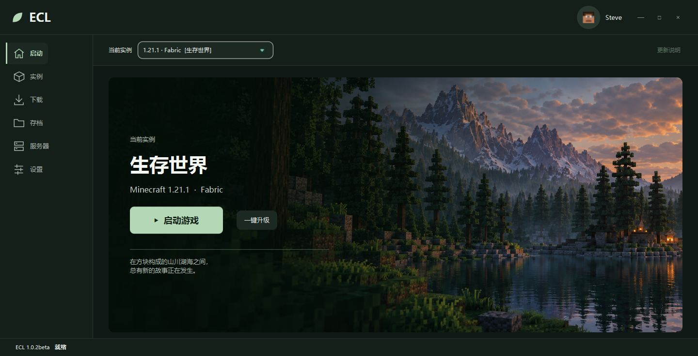
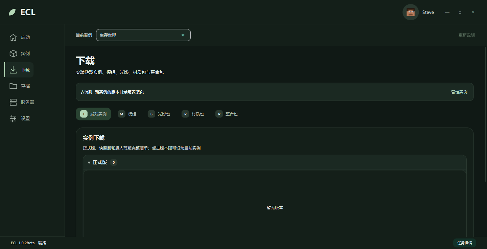
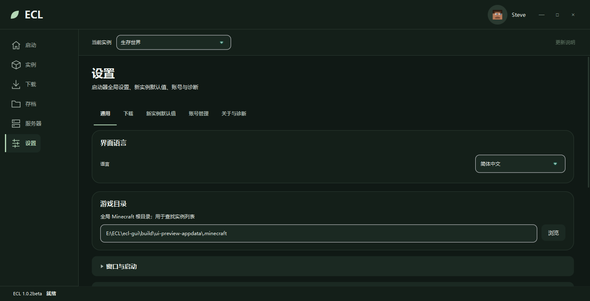

# ECL

[](https://github.com/linrenhao0813-cmd/ECL/actions/workflows/ci.yml)

ECL 是一个基于 JavaFX 的 Minecraft Java 版启动器，覆盖版本安装、账户管理、内容下载、整合包维护与服务器浏览等常用流程。界面为固定深色的森林绿主题，支持简体中文、繁体中文和英文。

> 当前版本：`1.0.2beta` · Windows 平台 · 从源码构建需要 JDK 21

## 界面预览

以下为使用隔离数据目录生成的启动器界面快照。

> 以下三张截图于 2026-10-18 使用当前 `1.0.2beta` 代码重新生成并核对。首页使用示例实例，下载页为离线布局预览；具体模式与重拍命令见 [docs/images/README.md](docs/images/README.md)。

### 启动首页



### 内容下载



### 通用设置



## 功能

### 游戏版本与实例

- 安装 Minecraft 正式版、快照和愚人节版本，下载时可选择客户端或服务端。客户端校验游戏、资源和依赖文件；服务端支持原版、Fabric、Quilt、Forge、NeoForge，模组服务端需明确选择兼容的加载器版本。
- “实例”菜单从用户配置的 `.minecraft/versions` 中检测已有实例，直接切换启动目标；不会默认选中在线版本从零下载。
- 带加载器的实例使用隔离运行目录，原版实例共享游戏根目录。
- 实例详情的“启动设置”只编辑当前查看的实例，可单独选择 Java、自动或手动最大内存（MiB）和安全的自定义 JVM 参数；恢复新实例默认值后仍需保存才写入。
- “检查与修复”先显示元数据、客户端 JAR、依赖库、原生库、资源索引、资源对象、客户端日志配置与加载器依赖的校验结果，再由用户确认修复。来源或摘要不足的内容显示为“无法验证”，不会推测下载地址或自动修改用户模组。
- 打包版可为所选实例创建桌面或开始菜单快捷方式：实例详情顶部“更多操作”菜单提供“创建桌面快捷方式”和“创建开始菜单快捷方式”，快捷方式以 `--instance <实例 ID>` 直接启动该实例（会先把该实例设为启动目标）。从源码运行、找不到 `ECL.exe` 时会提示需要打包版。
- 实例详情顶部“更多操作”菜单还提供“删除实例”：二次确认后只删除该实例的版本目录（模组、存档与实例启动配置随之删除，共享 `libraries` 与 `assets` 不受影响）；实例正在运行、启动准备中或正被其他操作占用时拒绝执行，删除成功后清空指向它的启动目标。

### 模组加载器

- 安装 Fabric、Quilt、Forge、NeoForge 加载器；下载非原版实例时，先选择加载器类型，再从当前 Minecraft 版本的兼容列表中自行选择加载器版本，选定后才能开始安装。列表加载失败时可重新加载。选择 Fabric 时还须自行选择兼容的 Fabric API 版本，安装时使用选定版本。
- NeoForge 兼容版本查询支持 Minecraft 26.x；运行官方安装器时优先使用游戏元数据要求的 Java 版本。
- 首页“一键升级”先预览版本和文件计划。普通实例可跳过单项模组更新；确认后先解析依赖并再次展示新增依赖，再按预览固定版本执行。更新中途或版本、文件指纹变化时会失败并要求重新检查。整合包仍按整包更新，预览会列出新增、替换、删除和保留的文件，不提供包内逐模组选择。
- 更新实际改变文件后，实例详情可“恢复上次升级”。恢复前会验证身份和完整性，并比较升级后的文件；修改冲突会列出并要求确认。回退范围仅含这次管理的模组文件、索引、版本配置和整合包清单/受管理文件，不包括共享 libraries/assets、存档或其他未改动的用户文件。

### 账户与皮肤

- 支持离线账户和 Microsoft 设备码登录，保存的凭据采用加密存储。旧版 Yggdrasil 账号记录保留，但不再提供外置登录。
- `accounts.json` 根节点必须为 JSON 数组；结构异常时明确报错并保留原文件，新增账户不会覆盖异常内容。
- Microsoft 登录默认使用内置公共客户端 ID，可通过 `ecl.microsoft.clientId` 或环境变量 `ECL_MICROSOFT_CLIENT_ID` 覆盖。
- Microsoft 正版账户可上传官方皮肤；离线账户可导入本地皮肤，并在启动游戏时自动注入。两种方式均支持 64×64 或 64×32 的 PNG（最大 1 MiB），可选经典（宽手臂）或纤细（细手臂）模型。
- 窗口右上角的玩家头像显示 Microsoft 账号或已导入离线皮肤的头部；没有可用皮肤时显示史蒂夫头部。

### 内容下载与 Mod 管理

- 按 Minecraft 版本和加载器筛选 Modrinth 的模组、光影包、资源包和整合包，支持依赖解析与事务式安装。
- Mod 管理支持多选顺序更新、批量启用、禁用和卸载，本地 `.jar` 文件可拖入启动器导入当前实例。
- 模组管理、安装、扫描写入与中断事务恢复均检查持久化游戏进程标记；关闭并重开启动器后仍不能改写运行中实例，取得实例操作锁后会再次核对状态。
- 已安装项目的同名 JAR 不允许被其他项目覆盖；共享必需依赖记录所有依赖者，启用、禁用和卸载按完整关系检查。旧索引缺少完整关系时，先联网扫描确认依赖；离线扫描不会将未知关系视为已确认。
- 禁用的模组不会被当成可用的必需依赖；需要它时会纳入安装计划。冲突声明指定版本时只匹配该版本，已经禁用或将被计划替换的旧版本不会误阻止安装。
- 下载默认并行数按处理器数量在 4–8 之间调整，支持断点续传与失败换源；用户取消显示为“已取消”而非“下载失败”。
- 游戏文件传输失败后保留稳定暂存路径下的断点与 HTTP 校验标记；重试时仅复用同源且具有 ETag 或 Last-Modified 的断点，完整大小与 SHA-1 校验通过后才替换目标文件。
- 低速限流按实际字节分段等待；HTTP 响应正文停顿也会超时退出，避免收到响应头后一直卡住。

### 整合包

- 导入 Modrinth `.mrpack` 整合包。
- 已记录 Modrinth 来源的整合包可通过首页“一键升级”检查并更新当前实例。
- 为保证升级前恢复点完整，首页升级要求旧的 `.ecl-pack-manifest.json` 有效；缺失或损坏时会停止升级，需先人工处理清单。
- 整合包更新只会删除仍匹配旧清单哈希的旧文件；修改过的旧文件会保留并在计划或摘要中说明。
- 新版整合包覆盖旧清单之外的已有文件前也会备份原内容，恢复上次升级时还原这些文件；真正新增的文件才会被移除。
- 支持 `client-overrides` 覆盖公共 `overrides` 中的同路径文件；异常恢复仅处理所属实例的事务。

### 服务器

- 浏览公开 Minecraft 服务器目录，搜索、查看在线状态、复制地址或作为下次启动的直连地址。
- “服务器”页的“本地服务端”标签可导入服务端 JAR，为每个服务端保存独立目录、Java 路径和最大内存配置，启动、正常停止、查看日志并发送控制台命令。
- 导入服务端时会探测可用 Java；打包运行时没有 `java.exe` 且未找到其他 Java 时，会先提示选择 Java 可执行文件，取消则不导入。
- “下载 → 游戏实例”选定 Minecraft 版本后，可选择“客户端”或“服务端”，再选择原版或模组加载器。服务端安装到服务端下载目录下的独立子目录，包含所需 JAR、依赖及启动脚本，不安装客户端、不改变客户端启动目标、不自动启动；模组可在安装后自行添加。安装需本机已有匹配的 Java，旧版 Forge 需对应主版本，Quilt 安装器另需 Java 17 或以上。
- 首次启动前需要用户明确接受 [Minecraft EULA](https://www.minecraft.net/eula)。原版服务端 JAR 可在本地服务端标签导入，导入会复制文件，原下载文件保留；模组服务端保留完整安装目录并使用生成的启动脚本，不通过单 JAR 导入运行。
- 服务端运行期间禁止改写启动配置或 EULA、重复启动。切页不会终止服务端。建议关闭启动器前先正常停止服务端；关闭后重开仍能识别运行状态和查看日志，但无法重新连接旧进程的控制台输入。

### Java 与启动配置

- 自动选择合适的 Java，本机缺少匹配运行时时可下载 Eclipse Temurin JRE（下载后校验 SHA-256）。
- 兼容旧版启动元数据中的原生库路径与用户属性参数。
- 旧版资源布局按已下载的资源索引识别：虚拟资源位于 `assets/virtual/<索引 ID>/`，`resources/` 写入实际运行目录，支持自定义目录和隔离实例；启动前会补齐旧安装的资源视图并比较同大小文件的内容。
- 版本声明的客户端日志配置在安装、修复和启动准备阶段校验大小与 SHA-1，保存于 `assets/log_configs/`；安装成功后离线启动可复用。继承版本升级依赖时使用子版本的 artifact，不沿用旧版本的下载地址或摘要。
- 启动时按实例读取已保存的 Java、内存和 JVM 配置；“设置 → 新实例默认值”只作为新实例的初始值。实例详情的“启动设置”弹窗显示自动模式的生效规则，并可在保存时拒绝运行中、启动准备中或其他实例操作。

### 其他

- 崩溃报告中文诊断、世界备份。
- 世界备份与恢复会检查持久化游戏进程标记；关闭并重开启动器也不能覆盖仍在运行的游戏。还原目录前先写入持久化日志；中断后在下一次备份、恢复或游戏启动前回滚，损坏或缺失的恢复日志会保留原始文件并阻止继续操作。
- 世界设置编辑保留 NBT 字符串的游戏编码，包括 emoji；游戏仍在运行时，重新打开启动器也不能改写存档。

## 快速开始

```powershell
git clone https://github.com/linrenhao0813-cmd/ECL.git
cd ECL
.\gradlew.bat run
```

首次构建会通过 Gradle Wrapper 自动下载 Gradle 9.8.0 与项目依赖，无需另行安装 Gradle。运行启动器、登录、下载游戏或在线内容时需要网络连接。

### 环境要求

- Windows
- JDK 21

若 `java` 不在 `PATH` 中，请在同一 PowerShell 会话里配置 JDK 21 的 `JAVA_HOME` 和 `PATH`。

## 图形界面使用

窗口使用固定五区结构：顶部标题栏（ECL 标识、账户入口、窗口控制）、左侧导航栏（启动、实例、下载、存档、服务器、设置）、工作区顶部的实例栏、页面工作区，以及底部状态栏与任务入口。实例栏显示当前启动实例，可直接切换实例；不再显示重复的 Minecraft 版本与加载器徽章，“更新说明”入口固定在最右侧。实例管理从左侧“实例”导航进入，实例列表可在实例页刷新。窗口宽度不足时左侧导航自动收成图标栏，实例页改为上下单栏，页面按可用空间布局。窗口初始与最小尺寸按屏幕可用逻辑区域计算，适配 Windows 100%、125% 和 150% 缩放。

页面统一使用 4/8/12/16/24/32 的间距梯度和固定字号层级：页面标题 28 px、区块标题 16 px、正文 13 px、辅助信息 11–12 px，内容卡片统一内边距 18×20 与 12 px 行间距。设置页与实例、下载、存档、服务器页一样带页面标题与用途副标题；实例概览卡片标题为“实例信息”，不与“概览”标签重复；首页“一键升级”使用次按钮样式。

**启动目标与查看目标相互独立。** 实例栏、首页和“一键升级”操作的是启动目标；实例页列表里选中的行只是“正在查看的实例”，通过顶部实例下拉框切换下一次启动的实例；实例详情不再提供“设为启动目标”按钮或启动目标徽章、信息行。启动目标由独立的实例选择状态维护并持久化到 `settings.json` 的 `selectedVersion`，不依赖任何控件的存在。

1. **实例页**：左侧列出 `.minecraft/versions` 中可启动的实例（收藏的排在前面），右侧只保留“概览”标签和打开目录；“启动配置”“组件与维护”子菜单已移除。实例详情从左侧“实例”导航进入，设置菜单不再提供“实例设置”子菜单。
   - 概览顶部提供“启动设置”（`#instance-launch-settings`）、“检查与修复”（`#instance-check-repair`）、“恢复上次升级”（`#instance-restore-last-update`）、“更多操作”菜单与“打开目录”；实例不存在或正忙时按钮为禁用状态。
   - “更多操作”菜单（`#instance-more-actions`）包含“创建桌面快捷方式”（`#instance-create-shortcut`）、“创建开始菜单快捷方式”和“删除实例”（`#instance-delete`）。创建快捷方式会先把该实例设为启动目标，再生成 `--instance <实例 ID>` 的快捷方式；删除实例需要二次确认，只删除该实例版本目录，运行中或正忙时拒绝执行，成功后清空指向它的启动目标。
   - “启动设置”打开单实例的启动配置弹窗，可分别设置 Java（自动/自定义）、最大内存（自动/自定义 MiB）与自定义 JVM 参数，并显示自动模式的生效规则；保存时会拒绝运行中、启动准备中或已被其他实例操作占用的实例，恢复默认值后仍需保存才写入 `.ecl/config/launch-profile.json`。
   - “检查与修复”先给出元数据、客户端 JAR、依赖库、原生库、资源索引、资源对象、客户端日志配置与加载器依赖的逐项校验结果（`已校验`/`缺失`/`损坏`/`无法验证`），只有存在可修复项时才允许确认修复；修复期间会抢占实例操作锁，若校验指纹已变化则要求重新检查。旧版 `resources/` 按当前实例的实际运行目录生成。
   - “恢复上次升级”只在存在恢复点时可用，会先校验恢复点身份与备份 SHA-256，再列出将被还原的文件；升级后文件被改动时会列出冲突并要求确认，恢复过程可中断续做。
   - 概览卡片标题为“实例信息”，显示 Minecraft 版本、加载器、实际运行目录、实例 ID 与运行状态，并提供**显示设置**：自定义名称、收藏、封面图片。这些只写入 `<数据目录>/instances/display.json`，不会修改实例文件。
   - 顶部切换启动目标后，概览仍保留正在查看的实例及未保存的显示设置。
   - 保存启动设置、完成检查修复或升级恢复只刷新状态，不覆盖尚未保存的显示名称、收藏和封面草稿。
   - 安装新实例请进入“下载 → 游戏实例”；实例页不再显示“安装新实例”按钮。
2. **下载页**：顶部为横向分类（游戏实例、模组、光影包、材质包、整合包），分类下方常驻“安装到”提示条：模组等内容显示当前目标实例，“游戏实例”显示版本目录与安装页。独立“服务端”分类已移除，服务端下载统一从“游戏实例 → 选择版本 → 服务端”进入。安装页不再显示独立“安装进度”卡片，“开始安装”位于“客户端／服务端”选择行的最右侧，进度统一通过底部“任务详情”查看；安装完成或失败仍在类型选择区底部提示。离开内容页后再返回时会**回到上次的分类并恢复模组搜索词**；切换实例会重新筛选兼容性并丢弃旧上下文返回的过期结果。
3. **设置**：保留“通用”“下载”“新实例默认值”“账号管理”“关于与诊断”五个标签，按使用场景分组。通用页直接编辑游戏根目录，窗口、直连、处理器、启动行为与“减少动画”集中在可折叠的“窗口与启动”区域，自动备份集中在可折叠的“存档自动备份”区域；低频选项默认收起，语言选择即时生效；通用页不再提供“目录快捷入口”区域。下载页分“下载速度”和“内容更新”；新实例默认值分“运行参数默认值”和“实例目录默认策略”，默认隔离不再放在下载页。账号页集中展示登录、已保存账号与皮肤操作，移除重复的登录按钮。关于页展示实际启动器 Java 运行时版本，日志、崩溃报告与欢迎向导集中在“诊断与帮助”。通用、下载与默认值均支持显式保存、放弃修改；切换标签、左侧导航、语言或重建页面前会检查未保存修改，失败保留输入并回滚内存设置。实例页保留概览与显示设置；切换实例、刷新列表或离开实例页时检查未保存的显示修改。兼容的全局设置弹窗复用通用页的表单与保存逻辑，不改写实例启动配置或新实例默认值。
4. **服务器页**：分为公开目录和本地服务端两个标签。公开目录可复制地址或设置下次直连，直连地址跟随启动目标，未选择实例时会先提示选择。本地服务端提供 JAR 导入、Java/内存配置、EULA 确认、进程控制和日志控制台。
5. **存档页**：按实例分组列出存档，可编辑难度、游戏模式与命令开关（保留 NBT 字符串编码，包括 emoji），并可打开存档目录或所在实例；页面标题右侧的“备份管理”（`#world-saves-open-backups`）打开备份弹窗，可创建、恢复、删除世界备份并配置是否包含模组/光影/材质包/配置。
6. **皮肤**：通过窗口右上角账户入口进入账号设置，正版账户选择“上传皮肤”，离线账户选择“导入皮肤”；离线皮肤仅保存在本机 ECL 数据目录，可随时“清除皮肤”。账号页顶部集中显示已保存的 Microsoft 账号数量，并提供“重新登录 Microsoft”入口，登录失效时不会成为死路。
7. **无障碍**：图标按钮均带提示与无障碍名称；关闭弹窗（如全局游戏设置）后键盘焦点返回打开它的控件；页面切换动画由设置页通用标签“窗口与启动”中的“减少动画”开关（`#settings-reduce-motion`，默认关闭，写入 `settings.json` 的 `reduceMotion`）或系统属性 `ecl.reduceMotion` 关闭。

“减少动画”同时关闭任务进度的自定义脉冲；服务端状态轮询和模组搜索防抖继续运行，以保持状态刷新和请求频率控制。
启动前补齐游戏文件的下载最多等待 10 分钟，超时后取消该次下载、解除忙状态并允许重试。
桌面和开始菜单快捷方式在后台创建，PowerShell 执行有超时限制，完成或失败后在状态栏反馈。

首页主区域显示当前实例，仅提供启动和“一键升级”操作；切换实例使用顶部实例栏，实例、模组与存档管理从对应导航入口进入。**主按钮始终反映真实状态**：

| 状态 | 按钮 / 提示 |
| --- | --- |
| 没有本地实例 | “安装游戏”，跳转下载页的“游戏实例”分类 |
| 有实例但未选择 | “选择实例”，跳转实例页 |
| 已就绪 | “启动游戏” |
| 正在准备或补齐依赖 | 按钮禁用并显示当前阶段，防止重复启动 |
| 当前实例正在运行 | “游戏运行中”（禁用），提示行提供“查看任务” |
| 微软登录失效 | “重新登录”，跳转账号设置 |
| 上次启动失败 | “重新启动”，提示行显示失败摘要并提供“打开日志目录” |

背景区域随窗口高度伸展，图片按比例铺满。

底部状态栏显示启动器版本与当前任务摘要，右侧“任务详情”按钮仅在“下载”菜单中显示，按需展开面板；其他菜单隐藏该按钮且不占位。面板列出每个下载、安装与升级任务的**目标、当前阶段、进度、状态、错误摘要**；仅在任务可取消时显示“取消”，仅在同组最新尝试已失败或被取消时显示“重试”。每次重试都会执行界面初始化与完成处理，取消排队任务也会解除忙碌状态。共享下载进度条也显示在这里，因此切换页面不会丢失任务反馈。任务数量由下载任务中心实时上报，与首页控件是否可见无关。

选择带 Fabric、Quilt、Forge 或 NeoForge 的实例后，点击首页“一键升级”，启动器会升级加载器、补齐当前加载器缺失的依赖库、识别本地模组并顺序安装兼容更新，进度和结果显示在按钮下方。未选择实例时按钮不可用，普通原版实例不支持组件升级，运行中的实例拒绝升级。禁用、未知来源、损坏或重复项目的模组会跳过；单个模组失败会保留旧文件并继续其他更新，已成功的更新保留，可再次点击重试。整合包实例会检查并事务式安装作者发布的最新兼容整包版本，不再单独升级包内加载器和模组；遵循发布通道且不跨 Minecraft 版本或加载器类型。未记录有效 Modrinth 来源的整合包会提示重新导入，不会改动组件。

手动放入运行目录、尚未建立索引的模组被联网识别后，升级计划会保留其旧 JAR 路径；确认更新时由事务替换旧文件，避免新旧版本同时留在 `mods` 中。预览不写入模组索引。

离线皮肤与玩家名（含大小写）绑定，更改玩家名后需要重新导入。

### 公开服务器目录说明

公开服务器目录来自第三方服务。目录收录不表示 ECL、Mojang 或 Microsoft 对服务器内容、安全性或运营方式的认可，请自行判断后再连接。

## 构建与验证

以下命令均在仓库根目录执行。

### 测试与静态检查

```powershell
.\gradlew.bat check
```

`check` 会运行 JUnit、Checkstyle、SpotBugs 和 JaCoCo 报告任务，并对核心模块和 GUI 模块执行覆盖率下限校验：

| 模块 | 行覆盖率 | 分支覆盖率 |
| --- | --- | --- |
| `ecl-core` | 60% | 40% |
| `ecl-gui` | 20% | 15% |

Checkstyle 配置在 `config/checkstyle/`，SpotBugs 排除规则在 `config/spotbugs/exclude.xml`（当前以 `HIGH` 置信度报告、`MAX` 分析力度运行）。GUI 测试在 headless Monocle 下运行；core 与 GUI 测试均把 `user.home`/`APPDATA` 指向各模块的 `build/headless-test-appdata`，配置与日志不会写入真实用户目录。

运行单个测试示例：`.\gradlew.bat :ecl-core:test --tests com.ecl.util.FileUtilTest`（也可以用 `com.ecl.download.GameDownloaderTest` 等其他真实存在的测试类）。Gradle 依赖使用锁定和校验元数据。

### 依赖升级

依赖版本由 `gradle/libs.versions.toml` 管理，并由 `ecl-boot`、`ecl-core`、`ecl-gui` 三个 Java 模块各自的 `gradle.lockfile` 和
`gradle/verification-metadata.xml` 固定与校验（`ecl-dist` 只有打包任务，没有锁文件）。升级依赖时须一起更新受影响的锁文件及校验元数据，
审阅新增校验值，再用默认校验模式执行 `check` 和 `installDist`；不要在 CI 中关闭依赖校验。

单元测试中的 Java 运行时元数据使用公共 IP 字面量作为示例 URL，仅验证元数据与地址策略，
不依赖外部 DNS 或实际下载。HTTP、私有地址、无效校验和及超限大小均须被拒绝。

`gradle/verification-keyring.keys` 保存已信任的构建依赖发布者签名公钥。
公钥指纹与 `verification-metadata.xml` 中的信任范围一致，避免构建依赖密钥服务器的可用性。

CI 在 Windows 上执行检查，通过后生成名为 `windows-app` 的应用镜像产物。

### 构建与分发

```powershell
.\gradlew.bat build          # 编译并验证全部模块
.\gradlew.bat installDist   # 生成分发目录：ecl-boot/build/install/ECL/
```

### 界面快照

```powershell
.\gradlew.bat captureLauncherUi
```

默认输出 `ecl-gui/build/visual-qa/ecl-home.png`（文件名固定，与模式无关；可用 `-PuiSnapshotPath=...` 指定其他路径），使用隔离的数据目录，不会读写当前用户的 ECL 配置。未指定 `-PuiSnapshotMode` 时模式为 `home`，即启动后的初始首页（不注入示例实例）；要复现 README 的首页截图请显式使用 `forest`。

模式由“**基础模式 + 可选修饰后缀**”组合而成，不是互斥枚举。`LauncherUiSnapshot` 先剥离语言后缀，再用基础模式选择页面，最后读取修饰后缀：

- **语言后缀**：`-en`（英文）、`-zh-tw`（繁体中文，也接受 `-zhtw`），不带则为简体中文。快照会强制切到对应语言，不受上一次快照残留的语言设置影响。
- **修饰后缀**：`-compact`（1180×720）、`-expanded`（展开设置页折叠区）、`-details`（选中存档首行）、`-dark`（历史遗留；主题已固定为深色，**代码里没有任何分支读取这个后缀**）。另有 `-online` 只用于等待更久（6 秒，让在线请求返回），且它在代码中是若干精确模式名的一部分（`modrinth-online`、`content-*-online`），不是可自由拼接的后缀。
- **关键限制**：语言后缀只在按“前缀匹配”的模式上有效（`forest*`、`saves*`、`accounts*`、`local-versions*`、`downloads*`、`local-servers*`、`instance-loader-version*`、`instance-server-install*`、`settings-page*`、`settings-dialog*`、`modrinth*`、`backups*`）。按完整名称精确匹配的模式（`initial-dark`、`versions`、`versions-dark`、`instance-install-dark`、`loader-choice`、`skin-upload`、`content-*`、`settings`）追加 `-en`/`-zh-tw` 后会匹配失败并退化到普通首页；唯独 `servers-en` 是代码里单独列出的英文匹配名。

| 基础模式 | 说明 | 可叠加修饰 |
| --- | --- | --- |
| `forest` | 带固定实例（生存世界 / 原版探索）的森林首页 | `-compact`、`-en`、`-zh-tw` |
| `forest-empty` | 无本地实例的首页；`-empty` 是 `endsWith` 判断，所以 `forest-empty-en` 不会进入空实例分支，而是走普通 `forest` 分支（带示例实例） | 无 |
| `initial-dark` | 启动器初始场景（校验深色主题已应用） | 无 |
| `versions` / `versions-dark` / `instance-install-dark` | 下载页的游戏实例分类；`instance-install-dark` 额外打开安装器并选中加载器 | 无（`-dark` 已是名称一部分） |
| `downloads` | 内容页横向分类与“安装到”提示条（停在第 1 个分类“游戏实例”） | `-en`、`-zh-tw` |
| `local-versions` | 实例页列表 + 详情工作区 | `-compact`、`-en`、`-zh-tw`（`-config` 会直接报错：启动配置入口已移除） |
| `settings-page` / `settings-page-dark` | 设置页首屏（通用；低频选项默认折叠）。两者等价：`-dark` 后缀**当前代码不读取**（主题固定深色），只有 `downloads`/`defaults`/`accounts`/`about`/`expanded`/`compact` 参与分支判断 | `-downloads`、`-defaults`、`-accounts`、`-about`、`-expanded`、`-compact`、`-en`、`-zh-tw` |
| `settings-page-downloads` / `-defaults` / `-accounts` / `-about` | 下载速度与内容更新 / 运行参数与实例目录默认策略 / 账号管理 / 版本信息与诊断入口 | 同上 |
| `settings-dialog` | 全局游戏设置弹窗顶部 | `-bottom`、`-en`、`-zh-tw` |
| `settings` | 同 `settings-dialog`，并把弹窗滚到底部（旧名称保留） | 无 |
| `instance-loader-version` | 实例安装页与 Fabric Loader / Fabric API 版本选择（固定示例列表） | `-en`、`-zh-tw` |
| `instance-server-install` | 服务端安装页、加载器版本选择与独立下载目录（固定示例列表） | `-en`、`-zh-tw` |
| `loader-choice` | 游戏实例安装页的加载器选择行（固定 Fabric 示例），并自动滚到底部 | 无 |
| `skin-upload` | 账号页皮肤上传入口（强制 Microsoft 登录类型） | 无 |
| `modrinth` | 模组分类（带 Fabric 实例）；`modrinth-online` 多等 6 秒让在线请求返回 | `-en`、`-zh-tw` |
| `modrinth-vanilla` | 模组分类（原版实例，用于对比兼容性筛选） | `-en`、`-zh-tw` |
| `content-shader` / `content-resourcepack` / `content-modpack` | 光影包 / 材质包 / 整合包分类；对应的 `-online` 名称（`content-shader-online` 等）是独立精确模式 | 无（语言后缀不适用） |
| `content-server` | 服务端分类的旧名称；当前内容分类只有 4 个（模组/光影包/材质包/整合包），该模式会退回第 4 个分类“整合包”，不再展示服务端分类（`1.0.2beta` 起服务端从“游戏实例 → 服务端”进入） | 无 |
| `local-servers` | 服务器页“本地服务端”标签（导入示例服务端） | `-compact`、`-en`、`-zh-tw` |
| `servers` / `servers-dark` / `servers-en` | 服务器页“公开目录”标签 | 无（英文用 `servers-en`） |
| `saves` | 存档页 | `-details`、`-compact`、`-en`、`-zh-tw` |
| `accounts` / `accounts-microsoft` | 账号页；`-microsoft` 把登录类型切到 Microsoft（`accounts-*` 是前缀匹配，可叠加 `-en`/`-zh-tw`） | `-en`、`-zh-tw` |
| `backups` | 备份管理弹窗（自动创建一个示例存档与备份） | `-en`、`-zh-tw` |

示例：`.\gradlew.bat captureLauncherUi -PuiSnapshotMode=local-versions-en`、`.\gradlew.bat captureLauncherUi -PuiSnapshotMode=settings-page-expanded-compact`、`.\gradlew.bat captureLauncherUi -PuiSnapshotMode=saves-details`。

背景素材及生成说明位于 `ecl-gui/src/main/resources/images/`；背景中不含按钮或文字，交互均由 JavaFX 控件提供。

### Windows 应用镜像

```powershell
.\gradlew.bat packageWindowsApp
```

使用 Windows JDK 21 自带的 `jpackage.exe` 生成包含 Java 运行时的应用镜像，输出位于 `dist/windows/ECL/ECL.exe`。注意：该任务生成的是应用镜像而非单文件安装程序，发布时必须保留整个 `dist/windows/ECL/` 目录，`ECL.exe`、`app/` 和 `runtime/` 需保持原有相对位置。

当前启动器显示版本与 JAR 版本为 `1.0.2beta`；Windows 版本元数据只接受数字，因此 EXE 使用 `1.0.2`。
运行时、界面与打包版本统一来自 `gradle.properties` 的 `version`，经 `ecl-core:processResources` 写入 `ecl-build.properties`；发布 tag 必须与该值一致（允许 `v` / `V` 前缀）。例如：`.\gradlew.bat validateReleaseVersion "-PreleaseTag=V1.0.2beta"`。

### CI

GitHub Actions 在 Windows 上执行以下工作流：

- `ci.yml`：PR 触发依赖审查（`dependency-review`）；`verify` job 依次执行 `.\gradlew.bat check` 与 `.\gradlew.bat captureLauncherUi`，失败时上传 `build/reports`、`*/build/reports`、`*/build/test-results`，成功时上传 `ecl-gui/build/visual-qa` 快照；`package` job 依赖 `verify`，生成名为 `windows-app` 的应用镜像产物（`dist/windows`）。
- `release.yml`：推送 `v*`/`V*` tag（或手动 `workflow_dispatch` 指定已有 tag）时先运行 `validateReleaseVersion -PreleaseTag=<tag>`，版本不匹配立即失败；通过后运行 `check` 与 `packageWindowsApp`，把 `dist/windows/ECL` 压缩为 `ECL-<tag>-windows-x64.zip` 并创建 GitHub Release（tag 名含 `beta` 时标记为 prerelease）。

CI 使用 `gradle/actions/setup-gradle` 缓存 Gradle；依赖校验保持默认严格模式。

## 数据目录与实例配置

启动器数据默认保存于：

| 系统 | ECL 数据目录 | 默认游戏目录 |
| --- | --- | --- |
| Windows | `%APPDATA%\.ecl` | `%APPDATA%\.minecraft` |

数据目录保存版本元数据、库、资源、运行时、配置、备份和缓存；游戏目录可在设置中覆盖。

| 路径（相对数据目录） | 内容 |
| --- | --- |
| `settings.json` | 全局设置；损坏时原文件改名为 `settings.json.corrupt`（另见下文字段说明） |
| `accounts.json`、`skins/`、`skins.json` | 统一账户列表（凭据加密）与离线皮肤 |
| `versions/`、`libraries/`、`assets/` | 版本元数据、依赖库与资源文件 |
| `runtimes/` | 下载的 Eclipse Temurin JRE（`temurin-<特性版本>-windows-<架构>/`） |
| `servers/` | 本地服务端，每个服务端一个 UUID 目录 |
| `backups/` | 世界备份（每个实例一个子目录） |
| `instances/display.json` | 实例显示设置（自定义名称、收藏、封面） |
| `upgrade-recovery/` | 每个实例最近一次真实升级的恢复点 |
| `cache/` | Modrinth 图标与公开服务器目录等可重建缓存 |
| `authlib-injector.jar`、`authlib-injector.jar.sha256` | 离线皮肤注入代理及校验和 |
| `.ecl-download-locks/` | 共享文件发布锁（可删除，删除后仅剩锁文件重建开销） |
| `.secret.key` | 本地加密密钥（Windows 下由 DPAPI 保护，**不要手工删除**，否则已保存凭据需重新登录） |

> 运行日志保存在数据目录的 `logs/` 下，详见“故障排查”章节。

实例目录内部：

- `.ecl/config/launch-profile.json` — 实例启动配置，带 `schemaVersion` 的 UTF-8 JSON，临时文件 + 原子替换写入。实例首次读取时迁移现有全局 `javaPath`、`maxMemoryMb` 和 `jvmArgs`，旧全局设置保留为未迁移实例的默认值。
- `.ecl/config/instance-game-settings.json` — 实例运行目录是否覆盖全局隔离策略。
- `.ecl/game-process.json` — 运行中游戏的 PID 与启动时间。

Mod 安装、启用、禁用、卸载、索引扫描、启动设置保存、升级、回退和修复共享实例操作协调器。Mod 文件事务日志保存在 `<运行目录>/.ecl-mod-transactions/<事务 ID>/journal.json`；整合包事务日志保存在 `<实例目录的父目录>/.ecl-pack-transactions/<实例 ID>-<事务 ID>/journal.json`。

每个实例只保留最近一次实际产生文件变化的升级恢复点，位置为 `<ECL 数据目录>/upgrade-recovery/<profile ID>/active/recovery.json`，旧文件快照在同目录的 `payload/` 中。创建中及中断待恢复的文件位于 `pending/`；没有实际变化的检查、取消、无更新或准备失败不会替换现有恢复点。崩溃后实例启动会被阻止，直到在实例详情检查并完成或回退该恢复点。普通升级只记录选中的模组目标、旧模组路径、模组索引和实例版本元数据；整合包升级按旧/新清单记录受管理文件。共享依赖只保留为缓存，不回滚删除；存档和未被本次升级改动的文件不进入快照。`DownloadTaskCenter` 中的检查/修复进度为当前会话任务状态，不额外生成持久化日志。

本地服务端保存在 `<ECL 数据目录>/servers/<服务端 ID>/`，其中 `server.jar` 是导入副本，`profile.json` 保存启动配置，`console.log` 保存控制台输出；服务端自己的配置与世界也在此目录。服务端使用独立的进程标记识别运行状态，不依赖当前客户端实例。

实例启动配置只保存实际使用的 Java、内存和自定义 JVM 参数；含有性能预设、自动修复、自动生成 JVM 选项与备份策略字段的旧配置仍可读取；这些未接入运行流程的字段不再写入新配置。

字段级说明（每个键对应的源码位置与 JSON 示例）见[数据格式说明](docs/data-formats.md)。

## 网络请求与隐私

ECL 没有遥测、统计上报或崩溃上传：所有外发请求都由你主动触发的功能产生，且只发往下列服务。启动器会读取环境变量 `HTTPS_PROXY`、`HTTP_PROXY`、`ALL_PROXY` 作为 HTTP 代理。

### 游戏文件与元数据（Mojang）

| 域名 | 用途 |
| --- | --- |
| `piston-meta.mojang.com` | 官方版本清单 `version_manifest_v2.json` 与各版本 JSON（唯一信任来源） |
| `piston-data.mojang.com`、`launchermeta.mojang.com`、`launcher.mojang.com` | 客户端 JAR、服务端 JAR 等二进制文件 |
| `libraries.minecraft.net` | 依赖库 |
| `resources.download.minecraft.net` | 资源索引与资源对象 |

客户端日志配置从版本元数据 `logging.client.file.url` 声明的 HTTPS 地址下载，官方配置使用上表的 Mojang 文件域名；安装、检查修复或启动准备缺失/损坏的配置时触发，按声明的大小限制下载并校验 SHA-1。

下载失败时会尝试公共镜像：`bmclapi2.bangbang93.com`（BMCLAPI）、`launchermeta.fastmcmirror.org`、`launcher.fastmcmirror.org`、`libraries.fastmcmirror.org`、`resources.fastmcmirror.org`。镜像只用于下载带官方摘要的二进制文件，不会用镜像内容替换版本元数据。

### 账户登录与皮肤（Microsoft / Mojang）

| 域名 | 用途 |
| --- | --- |
| `login.live.com` | Microsoft OAuth 设备码授权与令牌刷新 |
| `user.auth.xboxlive.com`、`xsts.auth.xboxlive.com` | Xbox Live 身份验证与 XSTS 授权 |
| `api.minecraftservices.com` | 用 Xbox 令牌换取 Minecraft 令牌、查询游戏所有权与档案、上传正版皮肤 |
| `sessionserver.mojang.com`、`textures.minecraft.net` | 读取正版档案与皮肤纹理 |

仅在点击登录、刷新会话、上传皮肤或显示头像时请求；离线账户不会请求这些服务。保存的凭据在本机加密存储（见“安全与可靠性”）。

### 内容与加载器

| 域名 | 用途 |
| --- | --- |
| `api.modrinth.com` | Modrinth 搜索、项目/版本元数据（默认缓存 2 分钟、最多 3 次重试） |
| `cdn.modrinth.com`、`cdn-raw.modrinth.com` | 模组/光影/材质/整合包文件与项目图标 |
| `meta.fabricmc.net`、`meta.quiltmc.org` | Fabric / Quilt 加载器版本与 profile |
| `maven.fabricmc.net`、`maven.quiltmc.org` | Fabric / Quilt 安装器 |
| `maven.minecraftforge.net`、`maven.neoforged.net` | Forge / NeoForge 版本清单与安装器 |
| `api.adoptium.net` | 下载缺失的 Temurin JRE 元数据（随后从元数据返回的 HTTPS 地址下载，并校验 SHA-256） |
| `authlib-injector.yushi.moe` | 离线皮肤注入代理（authlib-injector） |
| `bmclapi2.bangbang93.com` | 上述 Mojang 文件与 authlib-injector 的镜像 |

在系统浏览器中打开的外链（不计入启动器直连请求）：玩家自选的服务器官网、`zh.minecraft.wiki`（“更新说明”）、`minecraft.net/eula`、`modrinth.com/mod/<slug>`。

### 服务器目录与在线状态

| 域名 | 用途 |
| --- | --- |
| `minecraft-java-servers.com` | 公开服务器目录（每页 100 条、最多 5 页，缓存 1 小时） |
| `api.mcsrvstat.us` | 服务器在线状态探测（失败地址有 60 秒冷却） |
| `127.0.0.1` | 离线皮肤本地 Yggdrasil 兼容服务，仅回环地址，不对外监听 |

公开服务器目录来自第三方服务。目录收录不表示 ECL、Mojang 或 Microsoft 对服务器内容、安全性或运营方式的认可，请自行判断后再连接。

### 内容简介自动翻译（会外发 Modrinth 项目简介）

当内容页需要显示 Modrinth 项目的**文字简介**时，如果该简介不含任何汉字，启动器会把简介文本发送给翻译服务，用于在中文界面里展示中文摘要。

- **触发条件**：文本非空、不含汉字（`[\p{IsHan}]`）、且尚未命中缓存。文本先 `strip()`，**最多取前 450 个字符**（超出部分被截断，不会发送完整长简介）。
- **发送顺序**：腾讯 Transmart（`transmart.qq.com/api/imt`）→ Google 翻译（`translate.googleapis.com`）→ MyMemory（`api.mymemory.translated.net`）。前一个返回空串或失败时才会尝试下一个，每个请求 8 秒超时。
- **缓存**：进程内会话缓存，最多 256 条、有效期 1 小时；失败结果不会缓存。重启启动器即清空。
- **触发位置**：模组列表行、模组详情、内容列表中的整合包摘要，以及模组浏览器的搜索结果行。**该行为与界面语言无关**：当前代码在任何语言下都会调用同一个翻译服务，不按语言跳过。
- **外发内容**：只有被截断到 450 字符的公开项目简介纯文本。不会发送账号、UUID、令牌、游戏目录、实例列表或任何本地数据。MyMemory 请求固定附带 `de=ecl-launcher@example.com` 参数（该 API 的邮箱参数，ECL 未使用真实邮箱）。
- **失败行为**：任一环节失败或全部失败时，界面直接显示原始英文简介，不阻塞页面，也不影响安装。
- **关闭方式**：**当前版本没有 UI 开关，也没有设置项或启动参数可以关闭翻译。** 如需完全禁止，可在 `hosts` 文件或防火墙层面屏蔽 `transmart.qq.com`、`translate.googleapis.com`、`api.mymemory.translated.net`；被屏蔽后简介会退回原文显示。后续版本计划提供设置项。

## 免责声明

- ECL 是非官方的第三方 Minecraft Java 版启动器，与 Mojang Studios、Microsoft 及其关联公司**没有隶属、赞助或背书关系**。
- “Minecraft”及相关名称、标识、游戏资源是 Mojang Studios 的商标或版权财产；本项目仅按官方公开的下载与认证协议访问玩家已合法拥有的游戏内容。
- 使用者需自备合法的 Minecraft 账户（正版账户或符合 Mojang 使用条款的离线用法），并遵守 [Minecraft 使用条款（EULA）](https://www.minecraft.net/eula)。本项目不提供、不分发游戏本体或账户。
- 公开服务器目录、服务器在线状态与内容翻译均来自第三方服务，其内容与可用性由对应服务方负责，不构成 ECL 的推荐或担保。
- 本软件按 GNU GPL v3.0 分发，不提供任何担保；因使用本软件造成的存档、实例或系统损失由使用者自行承担。涉及存档与实例的操作前请自行备份。

## 故障排查

### 日志在哪里

启动器日志与配置共用 `ECLConfig.getBaseDir()` 数据目录，通常位于 `%APPDATA%\.ecl`；`APPDATA` 缺失或为空时回退到 `${user.home}/.ecl`。

| 内容 | 路径 |
| --- | --- |
| 当前日志 | `<数据目录>\logs\ecl.log`（通常为 `%APPDATA%\.ecl\logs\ecl.log`） |
| 滚动日志 | `<数据目录>\logs\ecl.<日期>.<序号>.log.gz`（单文件 5 MB 滚动，保留 7 天） |
| 崩溃报告 | `<游戏目录>\crash-reports\`（未隔离实例即 `%APPDATA%\.minecraft\crash-reports`；隔离实例在实例运行目录下） |
| 本地服务端控制台 | `<数据目录>\servers\<服务端 ID>\console.log`（GUI 控制台只显示末尾 200 行） |

启动器内可直接打开：

- 设置 → 关于与诊断 → “诊断与帮助”区域 → **“打开启动器日志”** 按钮，打开 `<数据目录>\logs`；同区域还有 **“崩溃报告”** 按钮（打开当前实例的 `crash-reports`）与欢迎向导入口。
- 首页“上次启动失败”提示行的“打开日志目录”打开的是**当前实例运行目录下的 `logs`**（游戏日志，不是启动器日志），两者注意区分。

> 旧版本保存在 `%USERPROFILE%\.ecl\logs` 的历史日志保留原位，不自动迁移或删除；新日志统一写入数据目录。

### 游戏启动后立即退出或报错

1. 首页“上次启动失败”提示行的“打开日志目录”会打开当前实例运行目录下的 `logs`（游戏日志）；启动器自身的日志在 `<数据目录>\logs`（见上表）。崩溃报告在 `<游戏目录>\crash-reports\`。
2. 打开“设置 → 关于与诊断 → 诊断与帮助 → 崩溃报告”可直接定位到当前实例的 `crash-reports`。
3. 若提示“无法建立游戏进程运行标记”“实例中的游戏进程仍在运行”或“实例正在运行”，说明 `.ecl/game-process.json` 认为游戏还在跑：先确认任务管理器里没有残留 `javaw.exe`，再重试；不要手工删除标记文件，除非确认进程已退出。
4. 若提示恢复点未完成，必须在实例详情执行“恢复上次升级”（检查并完成或回退），否则实例会被持续阻止启动。

### 下载失败或换源

- 下载默认并行数为 `max(4, CPU 核数)`（上限 8），可在“设置 → 下载 → 下载速度”调整；“下载限速”填 `0` 表示不限速。
- 单文件失败会自动尝试镜像（见上文域名表）；持续失败时先检查代理与防火墙，再确认磁盘空间。
- 下载先写同目录临时文件，校验大小与 SHA-1 后原子替换，失败不会破坏已有文件；已完成的文件会跳过，可直接重试。
- 内容库图标加载失败只影响图标显示（显示占位图），不影响下载与安装。

### Java 缺失或版本不匹配

- “设置 → 新实例默认值 → 运行参数默认值”可选择 Java；实例详情“启动设置”可为单个实例指定 Java（自动或自定义）。
- 自动模式下启动器会挑选匹配的运行时；本机缺失时可下载 Eclipse Temurin JRE（下载后校验 SHA-256），安装到 `<数据目录>\runtimes\`。
- 运行服务端还需要本机已有的匹配 Java：旧版 Forge 需对应主版本，Quilt 安装器另需 Java 17 或以上；打包运行时没有 `java.exe` 时会先提示选择。
- 若 `java` 不在 `PATH` 中，请在同一 PowerShell 会话里配置 JDK 21 的 `JAVA_HOME` 和 `PATH`。

### 设置损坏与回退

- `settings.json` 无法解析（JSON 损坏、根不是对象等）时，启动器会把原文件移动到同目录的 `settings.json.corrupt`，然后从空设置启动；重新选择语言、游戏目录等即可，旧文件保留供排查。
- 若加密凭据无法解密（例如 `.secret.key` 丢失或被替换），启动器会提示重新登录，而不是把你当作已退出登录静默处理；重新登录即可恢复。
- 实例级配置（`.ecl/config/launch-profile.json`）损坏时，“启动设置”会给出重建提示；`instance-game-settings.json` 只影响运行目录选择。

### 服务端重启后无法输入控制台命令

服务端日志与控制台输出保存在 `console.log`，重启启动器后仍可查看末尾 200 行；但控制台输入**不会**自动恢复。

原因：命令通过启动器持有的子进程标准输入写入，且需要同时持有进程句柄。关闭启动器后进程仍在运行，重新打开启动器时无法接管旧进程的标准输入，`LocalServerManager.sendCommand` 因此拒绝命令并报“Console input is unavailable because this server was started by a previous ECL session”。界面会把该状态显示为“服务端仍在运行；此次启动器无法恢复该进程的控制台，请在原控制台正常停止”，此时“正常停止”“发送”与命令输入框都会禁用。

处理方式：

1. 在启动器内点“停止”（该按钮同样需要可控）；若已不可控，请在任务管理器结束对应 `java.exe`，或到服务端目录手动执行 `stop`（例如通过 RCON/其他控制台）。
2. 之后重新“启动”即可恢复控制台输入。
3. 建议关闭启动器前先正常停止服务端——这也是 README 服务器章节的建议。

### 其他常见问题

- **页面切换没有动画**：关闭“设置 → 通用 → 窗口与启动 → 减少动画”，或使用系统属性 `-Decl.reduceMotion=true`（系统属性始终优先生效，测试环境会强制开启）。当前该开关实际影响页面切换动画；进度条脉冲动画尚未接入该设置。
- **实例列表为空**：实例来自“设置 → 通用 → 游戏目录”指向的 `.minecraft/versions`；路径不对时会扫描不到。安装新实例请走“下载 → 游戏实例”。
- **快捷方式创建失败**：只有打包版（存在 `ECL.exe`）才能创建快捷方式；源码运行时会提示需要打包版。创建位置为桌面或开始菜单的 `ECL` 程序组。
- **从命令行直接打开某个实例**：打包版支持 `ECL.exe --instance <实例 ID>`（也接受 `--version <实例 ID>`），启动器会把它写入 `settings.json` 的 `selectedVersion` 作为启动目标。
- **磁盘占用**：`libraries/`、`assets/`、`runtimes/`、`cache/` 可安全删除（会重新下载或重建），但 `settings.json`、`.secret.key`、`accounts.json`、`skins/`、`instances/`、`upgrade-recovery/`、`servers/`、`backups/` 属于用户数据，删除会丢失配置、凭据、皮肤、实例显示设置、恢复点、服务端或备份。

## 安全与可靠性

- **来源校验**：版本清单和启动元数据只从 Mojang 权威地址读取，镜像仅用于下载带官方摘要的二进制文件；网络内容缺少有效摘要或大小时拒绝安装，HTTP 仅允许显式环回地址。
- **路径防护**：对版本 ID、继承版本和客户端 JAR 标识统一校验，通过规范路径检查将版本元数据和客户端文件限制在 `versions` 目录内；依赖库与资源路径同样检查目录边界。
- **运行时安全**：Java 运行时下载后校验 SHA-256；解压 Windows ZIP 时限制条目数、单文件大小、总大小和压缩比，拒绝越出运行时目录的条目。内容库图标仅从 Modrinth 的 HTTPS CDN 加载。
- **游戏进程管理**：监控使用守护线程，关闭启动器不会等待或终止运行中的游戏；`game-process.json` 使重新打开的 ECL 仍能阻止运行时配置覆盖和重复启动。
- **下载修复**：客户端下载、依赖库和资源先下载到同目录临时文件，验证大小与 SHA-1 后原子发布；失败不会删除或覆盖已有文件。修复前扫描不会写索引，修复时若任何客户端仍在使用共享依赖会阻止操作。
- **升级事务**：普通模组更新和整合包更新在首次修改前建立实例专属恢复点；回退清单只允许受限的实例文件、当前版本 JSON 与实例启动配置路径。恢复前验证备份 SHA-256、目标实例身份和升级后文件 SHA-256；新增文件会在回退时移除，修改冲突必须由用户确认。新恢复点完整后才替换旧恢复点。共享 libraries/assets 不会被快照或删除。
- **整合包事务**：Modrinth 整合包通过 `.ecl-pack-manifest.json` 记录受管理文件及 SHA-512。预览会在临时目录下载、校验并解析选定归档，确认后应用同一归档；未修改且被新版本移除的文件才会删除，修改过的移除文件会保留并警告，仍在新清单中的文件会在预览中标明替换。归档变更与 profile 元数据通过同一 journal 提交，失败时回滚；未提交的共享 loader 文件只作为缓存保留。

## 项目结构

文档索引：

- [源码阅读指南](docs/codebase-guide.md)：从入口到各业务模块的阅读顺序与关键流程。
- [架构说明](docs/architecture.md)：模块依赖、`ecl-core` 包职责表、`ecl-gui` 分层与流程时序。
- [数据格式说明](docs/data-formats.md)：`settings.json`、实例配置、恢复点、事务日志等持久化字段。
- [界面截图说明](docs/images/README.md)：三张截图的来源、对应快照模式与重拍命令。

游戏下载由 `GameDownloader` 按元数据、客户端、依赖库、资源文件的顺序编排；模组依赖解析在
`DefaultModDependencyResolver` 中分别处理必需与可选依赖。界面启动阶段位于 `LauncherUIView`，
窗口框架装配位于 `LauncherWindowLayout`，具体页面与交互继续由各自的页面工厂和工作流负责。

实例安装入口使用 `InstanceInstallPage`；Java 探测与选择使用 `JavaRuntimeUtil`，
诊断直接调用 `CrashAnalyzer`。账户与游戏目录分别由 `DefaultAccountService` 和
`DefaultGameRepository` 提供，不再保留未使用的服务接口、实例安装向导及管理模型。
后台线程工厂使用 Java 21 的平台线程 API，统一创建带编号的守护线程。

文件发布与持久化中的原子替换统一复用 `FileUtil.moveReplacing`，仅在文件系统不支持原子移动时回退普通替换；
各流程仍自行负责路径校验、锁、临时文件清理与事务恢复。SHA-1 的十六进制编码使用 JDK `HexFormat`，
Windows 保留名称校验复用 `TextUtil`。Microsoft 设备码使用不可变 record，文本输出隐藏登录信息。
界面直接持有认证与加载器工作流，Mod 操作复用既有状态管理与完成处理；已移除无调用的便利 API 和转发方法、
未显示的旧版本分类控件、未读取的服务字段和无引用的历史样式，不改变现有页面与下载页分类。

整合包更新通过 `ModpackUpdateService.checkUpdate` 检查选中的实例，不再保留全目录批量扫描入口。
实例安装完成后统一将新实例设为启动目标。
版本列表刷新与实际启动均读取独立启动目标状态；新整合包安装完成后先更新目标，再自动启动。

启动器仅保留已接入界面的 Modrinth 整合包安装与更新流程；未使用的通用整合包导入／导出服务、事件总线、认证工厂注册表、内容源注册表与事务包装接口已移除。账户存储继续兼容旧账号记录，内容元数据直接使用 Modrinth 提供者。实例启动、运行目录与显示设置共用现有的原子 JSON 写入逻辑。首页直接初始化共享控件，不再构建未显示的旧表单或隐藏操作按钮。

| 模块 | 职责 |
| --- | --- |
| `ecl-boot/` | JavaFX 图形启动入口（`com.ecl.ECL`） |
| `ecl-core/` | 认证、下载、游戏启动、实例、整合包等平台无关服务 |
| `ecl-gui/` | JavaFX 界面、控制器、样式与资源 |
| `ecl-dist/` | Windows `jpackage` 打包任务 |
| `config/` | Checkstyle 与 SpotBugs 配置 |

依赖方向为 `ecl-boot` → `ecl-gui` → `ecl-core`。生产代码位于 `src/main/java`，测试位于 `src/test/java`，运行时资源位于 `src/main/resources`。

## 技术栈

- Java 21 · JavaFX 21 · Gradle 9.8.0（Gradle Wrapper 固定分发校验和）
- Gson · Jackson · JNA · TwelveMonkeys ImageIO
- SLF4J · Logback
- JUnit 6 · TestFX（Monocle headless）· Checkstyle · SpotBugs · JaCoCo

## 许可证

本项目基于 [GNU General Public License v3.0](LICENSE) 开源。

## 贡献指南

贡献前请先阅读 [AGENTS.md](AGENTS.md)，了解项目结构、开发命令、编码风格、测试要求与提交规范。
